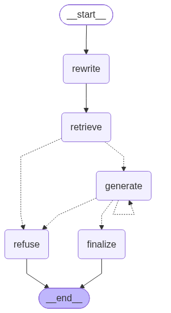
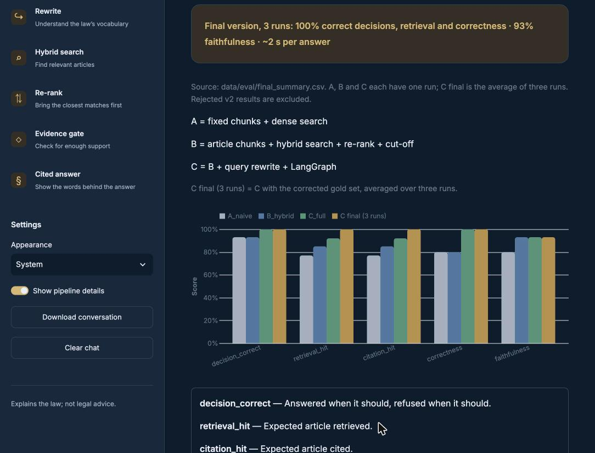
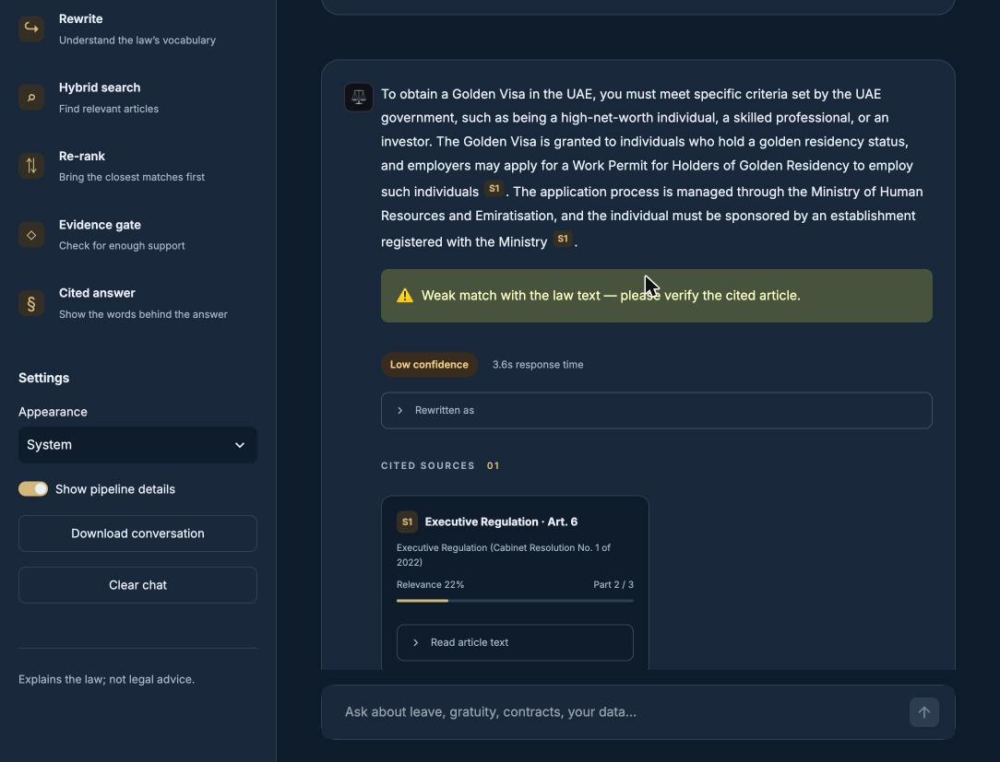
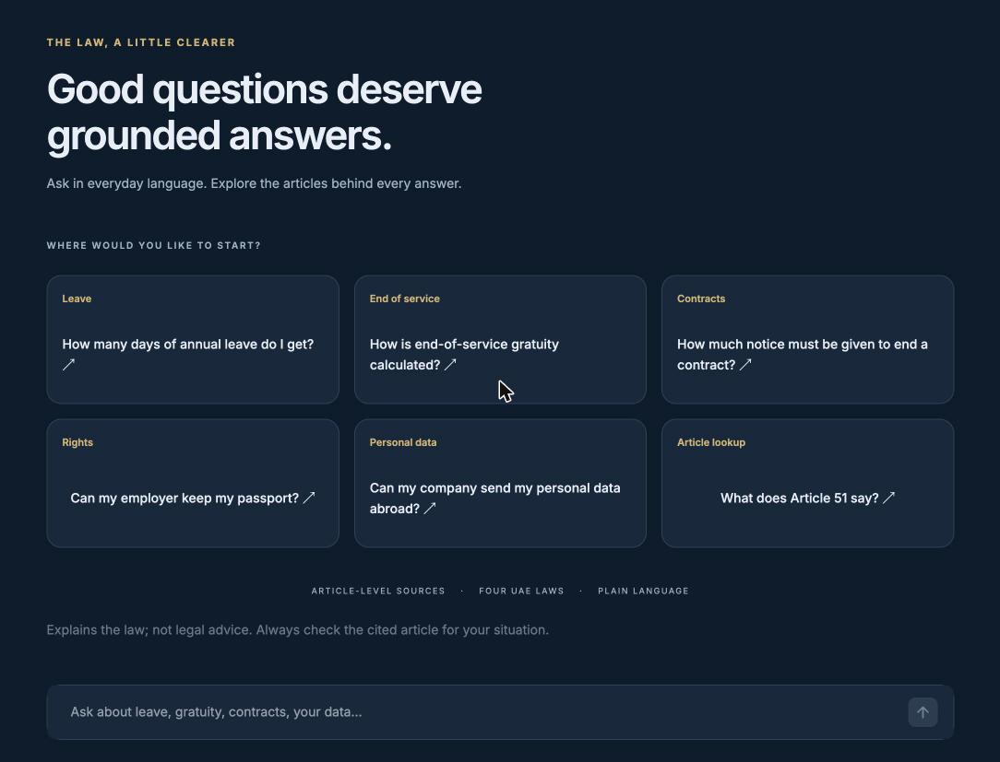
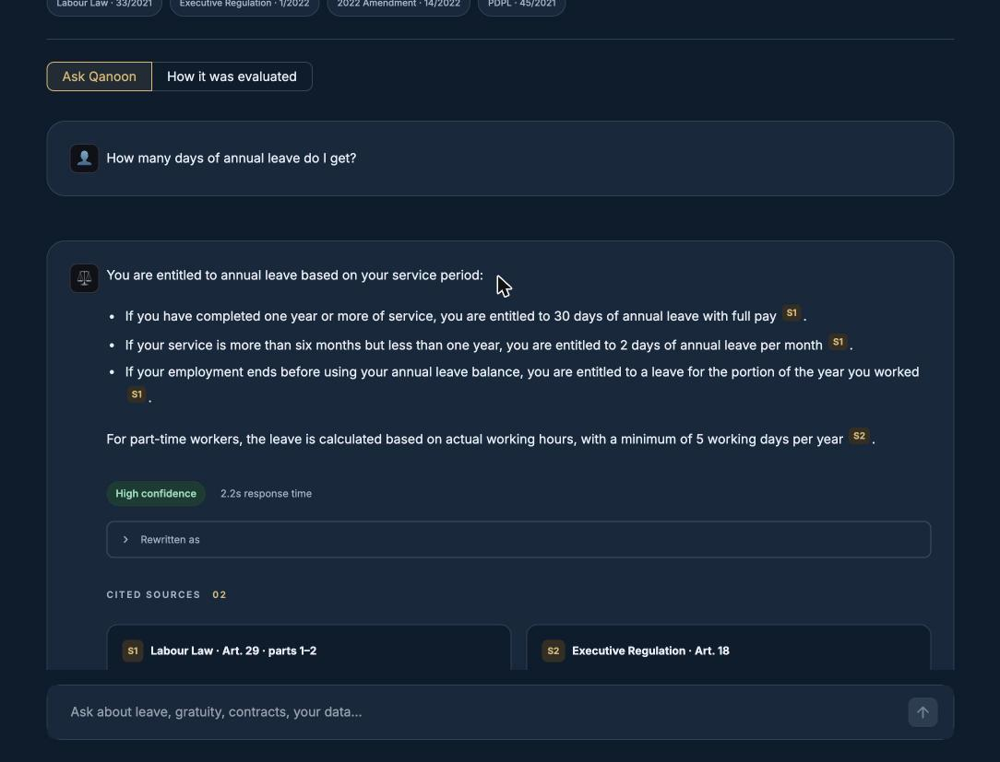
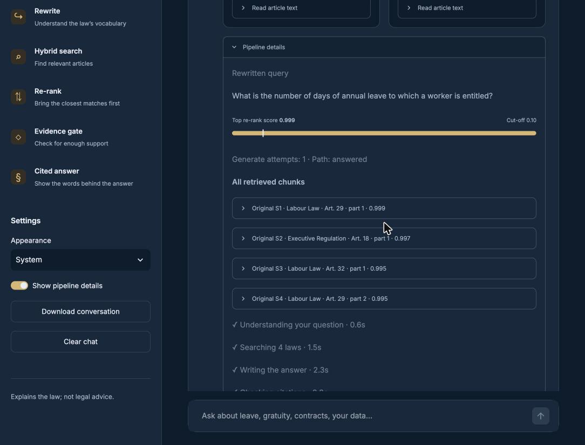
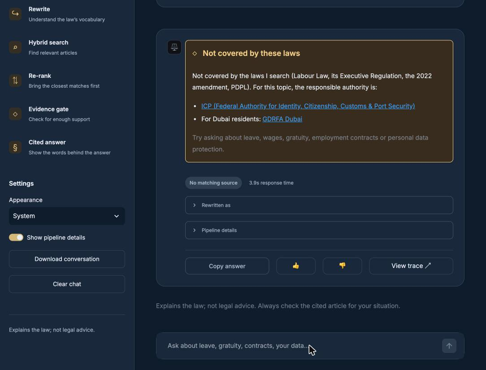
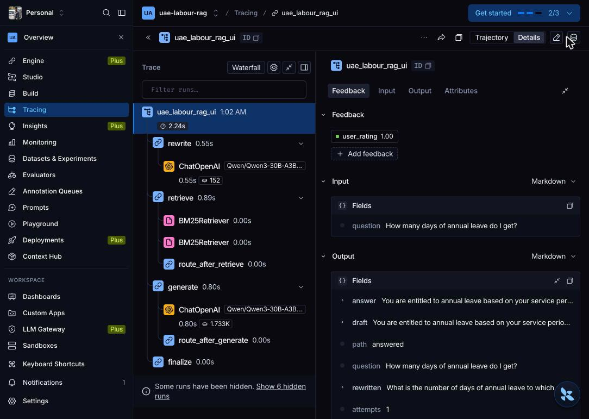

# **UAE Labour Law Assistant — a cited RAG chatbot over four UAE laws**

> PDF version: [PROJECT_REPORT.pdf](PROJECT_REPORT.pdf)

*Week 2 project · Mastering Agentic AI (The Gen Academy) · Code track: LangChain \+ LangGraph \+ LangSmith · Abdul Kader*  
**Demo video:** [https\://www\.loom.com/share/e35ced4d508c4193853a76a896e4425c](https://www.loom.com/share/e35ced4d508c4193853a76a896e4425c)

## **1\. Summary**

I built a RAG assistant that answers UAE employment and personal-data questions from the official text of four UAE laws and cites the exact article for every fact. On a hand-checked 15-question test set it made the right answer-or-refuse decision on every question, found and cited the expected article every time, and reached 93% faithfulness at about 2 seconds per answer (averaged over 3 runs). The biggest gains came from chunking by article and from re-ranking; query rewriting fixed vocabulary gaps, but only became safe once the original question was kept in the loop. Live testing then found near-scope and leading questions the test set had missed. A v3 with stricter citation rules raised faithfulness on an extended 18-question set from 83% to 91% (3 runs each).

## **2\. The one-liner and the framework**

**One-liner:** My RAG app helps UAE private-sector employees and HR officers answer labour-rights questions (leave, gratuity, notice, contracts, personal data) from the UAE Labour Law, its Executive Regulation, the 2022 amendment and the PDPL, in a web chat, with ≥ 90% faithfulness and under 8 seconds per answer.

| Field | My choice |
| :---- | :---- |
| Use case | Employees and HR officers ask plain-language labour-rights questions in a Streamlit chat app; every answer cites the article it comes from, and out-of-scope questions are refused. |
| Corpus | 4 official English PDFs from uaelegislation.gov.ae (108 pages, \~190,000 characters): Federal Decree-Law 33/2021 (Labour Law), Cabinet Resolution 1/2022 (Executive Regulation), Decree-Law 14/2022 (amendment), Decree-Law 45/2021 (PDPL). Source of truth: the UAE government legislation portal. |
| Ingestion \+ cleaning | PyPDFLoader → remove repeating page headers (after stripping the page number at the end of the header line) and bare page numbers → re-join hyphen-split words → join all pages into one text per law, because articles cross pages. |
| Ingestion \+ freshness | One-off batch ingest; re-run the pipeline when a law is amended. The 2022 amendment is in the corpus on purpose, and the prompt tells the model to follow the amended text. |
| Chunking \+ embedding | One chunk per article (long articles split at 1,500 characters with 150 overlap), with a header like "\[Labour Law — Article 29\]" inside each chunk. 204 chunks, average 187 tokens, max 345 — inside the 512-token limit of the embedding model BAAI/bge-small-en-v1.5 (384 dimensions, runs locally). |
| Retrieve | Chroma (dense) \+ BM25 (keyword), merged with Reciprocal Rank Fusion, top 10 → FlashRank cross-encoder re-ranker → top 4\. Refuse when the best re-rank score is below 0.10. |

## **3\. Datasets used**

* **Corpus:** the four laws above, downloaded as PDF. Lesson from day one: one download link labelled "Executive Regulation" actually delivered the 2022 amendment, so I checked the title page of every file before using it.  
* **Evaluation set:** 15 questions I wrote (10 normal, 5 edge cases: amendment/freshness, a hard plain-language question, a vague question, an out-of-scope question and a hallucination trap). Each has a reference answer and the expected article(s). I checked every reference against the law text before scoring. In v3 I added 3 questions found in live testing (18 in total): a golden-visa and an investor-licence question that must be refused, and a leading question ("What is my ideal notice period?").

The questions, reference answers and expected articles are in [src/evaluation.py](https://github.com/AbdulKader-devs90/uae-labour-law-rag/blob/main/src/evaluation.py); the LangSmith datasets are uae-labour-rag-eval-15 and uae-labour-rag-eval-18.

## **4\. Architecture**

**Indexing (once):** PDFs → load → clean → chunk by article → embed (bge-small) → store in Chroma \+ BM25 index.  
**Answering (per question), as a LangGraph flow:**

1. **rewrite** — the LLM rewrites the question into the law's vocabulary ("salary" → "wage", "passport" → "official documents").  
2. **retrieve** — hybrid search with both the original and the rewritten question, merged with RRF; preamble chunks dropped; each chunk re-ranked against both questions, keeping its best score; top 4 above the 0.10 cut-off kept.  
3. **evidence gate** — no chunk above the cut-off → **refuse** (no LLM call).  
4. **generate** — the LLM answers only from the numbered sources \[S1\]–\[S4\] and tags every fact; it replies NOT\_FOUND when the sources do not answer → **refuse**. A draft without tags is regenerated once. In v3 (strict mode) the prompt adds rules 9 and 10 and a stricter note when the best score is below 0.5, and a long untagged sentence that is not in the sources triggers one retry.  
5. **finalize** — code turns the \[S\#\] tags into readable citations such as "UAE Labour Law, Article 29". In v3 it also removes any long sentence that has no tag and is not supported by the sources, and refuses if nothing supported is left.

  
*The LangGraph flow, drawn by LangGraph from src/graph.py.*

| Component | Choice | Why |
| :---- | :---- | :---- |
| Orchestration | LangGraph | Branches (answer vs refuse), a retry loop, one trace per question |
| LLM | Qwen3-30B-A3B-Instruct on Nebius Token Factory | Course credits; OpenAI-compatible API; fast instruct model |
| Embeddings | BAAI/bge-small-en-v1.5, local | Free, fits the article-sized chunks |
| Vector store | Chroma, local | Small corpus, fast rebuilds for experiments |
| Keyword search | BM25 | Exact terms such as "Article 51", "gratuity" |
| Re-ranker | FlashRank ms-marco-MiniLM-L-12-v2, local | Precise ordering and a usable confidence score |
| Tracing and evaluation | LangSmith | Traces of every step; datasets and experiments |
| UI | Streamlit | Python-only chat app on top of the same graph |

## **5\. Prompts**

**Query rewrite (final, v1):**  
*You turn a user's question about UAE employment or personal data into a search query written in the formal vocabulary of UAE legislation. Examples of word changes: salary \-\> wage; boss/company \-\> employer; employee/staff \-\> worker; passport/visa papers \-\> official documents; fired \-\> termination of employment; vacation \-\> annual leave. Keep the meaning. Keep any article number the user wrote. Do NOT add the names, numbers or years of laws or decrees unless the user wrote them. Do not answer the question. Return ONLY the rewritten query on one line.*  
**Answer generation:**  
*You answer questions about UAE labour law and personal data protection. Use ONLY the numbered sources below. Do not use outside knowledge. Rules: 1\. End every sentence that states a fact with its source tag, e.g. \[S1\] or \[S1\]\[S3\]. 2\. If the sources do not answer the question, reply with exactly: NOT\_FOUND. 3\. If the Executive Regulation adds detail to a Labour Law article, include that detail. 4\. If the 2022 Amendment changes an article, follow the amended text and say it was amended. 5\. Be short and clear: 2–6 sentences or a short list. Copy numbers exactly. 6\. Explain what the law says; do not give personal legal advice. 7\. If the user asks what an article says, summarise that article from the sources. 8\. If the user names an article number without naming the law, use the law in the sources that contains that article, and name the law in your answer.*  
**v3 additions (strict mode, the default in the app):**  
*9\. Every sentence that states a fact must have a source tag. If you cannot support a sentence from the sources, leave it out. Never add facts from general knowledge (fees, authorities, procedures, eligibility) that are not written in the sources. 10\. If the question assumes something the sources do not say (for example an "ideal" or "usual" value), do not adopt the assumption: state what the sources actually say. When the best re-rank score is below 0.5, this note is added: "WEAK EVIDENCE: the sources only loosely match this question. Answer ONLY if the sources directly answer the question that was asked. If they only mention a related topic, reply with exactly: NOT\_FOUND".*  
**Evaluation judges** (Qwen3-235B-A22B-Instruct, a bigger model than the bot): a *correctness* judge (does the answer contain the key facts of the reference without contradicting it?) and a *faithfulness* judge (is every factual claim supported by the retrieved sources?), both returning JSON {score, reason}.

## **6\. Iterations**

| \# | Problem found | Change | Result |
| :---- | :---- | :---- | :---- |
| 1 | PDF page headers ended with the page number, so "remove repeated lines" missed them | Strip the trailing number before comparing lines | \~6% noise removed |
| 2 | Labour Law headings had reversed brackets "Article )2 (", a mention of "Article (5)" was taken as a heading, and PDPL Article 21 had no brackets | Heading must stand alone on its line; brackets optional either way; report missing numbers | All articles found: 74 / 39 / 3 / 31 |
| 3 | Fixed 800-character chunks split the annual-leave rule from its heading | One chunk per article with a header line | Heading, rule and citation stay together |
| 4 | "What does Article 51 say?" — dense search returned three wrong laws | Add BM25 and merge with RRF | Article 51 found, but ranked behind the amendment |
| 5 | RRF is rank-only and cannot tell which list was right | Cross-encoder re-ranker on the top 10 | Article 51 scores 0.87; wrong chunks ≤ 0.007 |
| 6 | "Can my employer keep my passport?" scored 0.002 and would be refused (law says "official documents") | LLM query rewriting | Article 13 found with score 0.998 |
| 7 | Side effect: the rewriter added the law's full title, so preambles and the amendment pushed Article 51 out | Do not add law names; drop preambles; re-rank against both the original and the rewritten question | All 6 test questions correct again |
| 8 | Model refused "What does Article 51 say?" although the article was in the sources | Prompt rules 7 and 8 | Answered and cited correctly |
| 9 | Answer logic hidden in one function; traces scattered | Rebuilt as a LangGraph flow with an evidence gate and a citation-retry loop | One trace per question, same results |
| 10 | Rewriter changed topics ("maternity leave" → "annual leave") | Rewrite prompt v2: "do not change the topic" | No effect on those rewrites and worse on the salary question over 3 runs → reverted to v1 |
| 11 | Live testing: "How can I get a golden visa?" was answered with outside knowledge (eligibility criteria), and "unless agreed in writing" stayed in the carry-forward answer | v3 strict mode: rules 9 and 10, a stricter prompt when the best score is below 0.5, and a sentence-level citation check with one retry | Faithfulness 0.83 → 0.91 on 18 questions × 3 runs; "in writing" 3/3 → 0/3 runs; outside knowledge 2/3 → 0/3 |
| 12 | The refusal card sent every out-of-scope user to MOHRE, but visas and residency belong to ICP and GDRFA | Route refusals by topic: ICP or GDRFA Dubai for visas and residency, MOHRE for work permits and establishment cards, u.ae otherwise | Golden-visa refusal now points to ICP and GDRFA Dubai |

## **7\. Evaluation report (15 and 18 questions)**

Three versions were run against the same LangSmith dataset with five evaluators: three code checks (correct answer-or-refuse decision, expected article retrieved, expected article cited) and two LLM judges (correctness, faithfulness).

| Version | Decision | Retrieval hit | Citation hit | Correctness | Faithfulness | Avg time |
| :---- | :---- | :---- | :---- | :---- | :---- | :---- |
| A — naive: fixed chunks, dense search only | 0.93 | 0.77 | 0.77 | 0.80 | 0.80 | 1.2 s |
| B — article chunks, hybrid search, re-rank, cut-off | 0.93 | 0.85 | 0.85 | 0.80 | 0.93 | 1.2 s |
| C — B \+ query rewrite, LangGraph (single run) | 1.00 | 0.92 | 0.92 | 1.00 | 0.93 | 2.0 s |
| **C final — 3 runs, corrected gold set** | **1.00** | **1.00** | **1.00** | **1.00** | **0.93** | **\~1.9 s** |

  
*The app's evaluation tab: A, B, C and C final (3 runs), from data/eval/final\_summary.csv.*  
**Where each version failed:**

* **A:** refused "What does Article 51 say?" (embeddings do not understand numbers); mixed the notice rules of three articles; missed the Regulation's "carry forward at most half" rule; cited Article 29 for a correct maternity-leave answer because the fixed chunk started in Article 29 — a wrong citation caused by wrong metadata.  
* **B:** refused the passport question (vocabulary gap) and answered "Tell me about leave" with only minor leave types.  
* **C:** one stable faithfulness failure — the carry-forward answer adds "unless agreed upon in writing", which is not in the law (v3 fixes it, see below). The salary question is the hardest case: with the final prompt it found Executive Regulation Article 16 ("Wages") in all 3 runs; my first gold set had listed only Labour Law Articles 22 and 45, so I added Regulation Article 16 after reviewing the outputs and say so here.

**Honest caveats:** 15 questions means one question moves a score by about 7 points, so single runs are noisy — the v2 prompt looked worse after one run and was confirmed worse over 3 runs. The LLM judge also gave version A's wrong salary answer a correctness score of 1; the faithfulness judge caught it, which is why I used several metrics and read every answer.

### **v3: guards found in live testing (18 questions, 3 runs)**

Testing the app by hand found failures the 15 questions missed: "How can I get a golden visa?" was answered with outside knowledge, and the invented condition "unless agreed in writing" stayed in the carry-forward answer. v3 adds rules 9 and 10, a stricter prompt when the evidence is weak (section 5), and a sentence-level citation check in the finalize step. I added three questions (a golden-visa and an investor-licence question, both to be refused, and "What is my ideal notice period?") and ran v1 and v3 three times each on all 18\.

| Version (18 questions, 3 runs each) | Decision | Retrieval hit | Citation hit | Correctness | Faithfulness | Avg time |
| :---- | :---- | :---- | :---- | :---- | :---- | :---- |
| C v1 (no guards) | 0.94 | 0.93 | 0.93 | 0.93 | 0.83 | 2.1 s |
| **C v3 (final)** | 0.93 | 0.93 | 0.93 | 0.89 | 0.91 | 2.1 s |

**What changed, question by question:**

* **Carry-forward annual leave: fixed.** v1 added "unless agreed in writing" in 3 of 3 runs; v3 in 0 of 3\.  
* **Golden visa: outside knowledge removed, but not refused.** v1 added eligibility criteria from general knowledge in 2 of 3 runs; v3 in 0 of 3\. v3 still answers, with a circular answer from Executive Regulation Article 6 (work permits for golden-residency holders).  
* **Ideal notice period: a retrieval failure, not a generation failure.** With the word "ideal", only Labour Law Article 1 (Definitions) is retrieved (top score 0.23) and Article 43 never is, so no prompt rule can fix it. Without "ideal", Article 43 is found.  
* **Investor licence:** refused by the score gate in both versions.  
* **Sentence remover:** it never had to remove a sentence in 54 runs; the prompt rule and the retry were enough.

**Decision: keep v3.** It meets the faithfulness target on the larger set (0.91 against 0.83) and stops outside knowledge leaking into answers. The correctness drop (0.93 to 0.89) is one question, and its cause is retrieval.

*Before v3: the golden-visa answer mixed in outside knowledge ("high-net-worth individual, a skilled professional, or an investor"); only the low-confidence warning flagged it.*

## **8\. The app**

A Streamlit chat app runs the same LangGraph flow. I named it Qanoon (Arabic for "law"). Codex built it in VS Code from a project brief, and it runs locally with streamlit run app/app.py. Features:

* **Live progress:** each step (understanding the question, searching the 4 laws, writing the answer, checking citations) ticks off with its time.  
* **Citations you can check:** each \[S\#\] tag is a chip linked to a source card with the law, the article, a relevance bar and the article text. Parts of the same article are merged into one card.  
* **Confidence:** a pill based on the best re-rank score, and an amber warning when the match with the law text is weak.  
* **Useful refusals:** the refusal card names the right authority: ICP or GDRFA Dubai for visas and residency, MOHRE for work permits and establishment cards, u.ae for other topics.  
* **Suggested questions** on the start screen and follow-up chips after each answer.  
* **Pipeline details:** the rewritten query, the top re-rank score against the cut-off, the route the graph took and every retrieved chunk with its score.  
* **Feedback and tracing:** thumbs up or down writes feedback to the exact LangSmith run, and View trace opens that run.  
* **Evaluation tab** ("How it was evaluated") with the A/B/C results chart and the metric definitions.  
* **Extras:** download the conversation, copy an answer, clear the chat, light, dark or system theme.

*Start screen with suggested questions.*

*An answer with a tag on every fact, a confidence pill and source cards (Labour Law Art. 29, Executive Regulation Art. 18).*

*Pipeline details: the rewritten query, the top re-rank score against the 0.10 cut-off, the route taken and every retrieved chunk.*

*A golden-visa question refused and routed to ICP and GDRFA Dubai.*

*The same run in LangSmith, with the feedback sent from the app.*

## **9\. How I used AI coding tools**

* **Claude (planning and learning partner):** reviewed the handout and solution kits, helped choose the use case and stack, guided each step with explanations, wrote the src/ modules from what we proved in notebooks, diagnosed bugs from my screenshots and LangSmith traces, and analysed the evaluation CSVs question by question.  
* **Codex / Claude Code in VS Code:** built the Streamlit UI from a project-context file (CLAUDE.md / AGENTS.md) and four staged prompts, with the rule not to change the evaluated pipeline in src/.  
* **My part:** ran every step myself in notebooks, read the raw outputs, chose between options, checked every reference answer against the law, and decided which iterations to keep or revert.

## **10\. Learnings**

* **Most RAG work is data work.** Page headers, reversed brackets and one mislabelled download would each have broken retrieval silently. Reading what the machine reads came before every fix.  
* **Chunk by the document's own structure.** Article chunks gave the biggest single gain (faithfulness 0.80 → 0.93) and made citations exact.  
* **Dense and keyword search fail in different ways.** Embeddings miss numbers; BM25 is fooled by keyword-heavy definition articles. Hybrid search plus a re-ranker covers both.  
* **A re-ranker cannot rescue what search never found.** The salary question's article ranked 15th and 35th — outside the candidates.  
* **Design the refusal first.** A cut-off chosen from data (out-of-scope ≤ 0.001, in-scope ≥ 0.5) refuses before any LLM call; a second refusal path catches what the gate misses.  
* **Never let one LLM step have the final say.** Query rewriting fixed vocabulary gaps but also invented topics; re-ranking against both questions made it safe.  
* **Small models follow examples more than "do not" rules.** The v2 instruction "never turn maternity leave into annual leave" was ignored.  
* **Every fix can have a side effect.** Re-running all test questions after each change found them; LangSmith traces showed exactly where.  
* **One evaluation run is not enough.** Repeat runs separated a real regression from noise.  
* **Live testing finds what a test set misses.** Near-scope questions (a golden visa) and leading questions (an "ideal" notice period) only showed up when I used the app, so I added them to the test set.  
* **Find out whether a failure is in retrieval or in generation before fixing it.** The "ideal notice period" answer was wrong because Article 43 was never retrieved. No prompt rule could fix that; the trace showed it at once.  
* **A refusal is also a hand-off.** Naming the authority that handles the topic (ICP or GDRFA Dubai for visas, MOHRE for work permits) makes a refusal useful.  
* **Setup lessons:** load\_dotenv does not overwrite values already loaded; LangSmith has separate US and EU regions; torch and onnxruntime can crash a Mac kernel when called in parallel; a setup function must never delete data by default (mine deleted earlier LangSmith experiments — recovered from saved CSVs).

## **11\. Next steps**

* Strip opinion words ("ideal", "best") in the rewrite step, and add an LLM relevance check ("does this source answer this question?") before generating, for near-scope questions such as the golden visa.  
* Ask a clarifying question for vague questions such as "Tell me about leave".  
* A larger test set (50+ questions) and the Arabic text of the laws.  
* Track amendments in metadata so the bot always cites the version in force.

*This assistant explains what the law says; it is not legal advice.*
